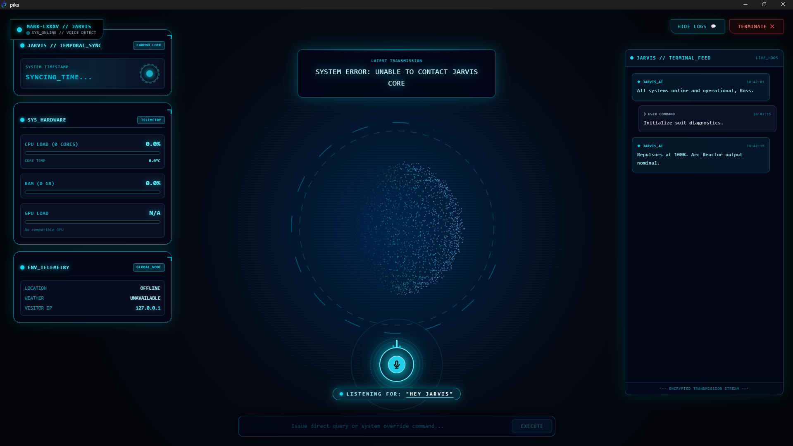

# Personal_Jarvis — JARVIS V1

Assistente desktop pessoal para Windows: HUD em React/Three.js, serviço Python local, cinco adaptadores de IA, memória SQLite, voz local e ferramentas com autorização humana.

V1 identifica esta primeira entrega do projeto; a versão interna do aplicativo é `0.1.0`. Recursos que ainda precisam de validação real estão registrados em `docs/VALIDATION.md`.



## LM Studio integrado

CONFIG → Inteligências → LM Studio → Consultar modelos → selecionar modelo → Carregar modelo selecionado → Usar LM Studio.

O catálogo nativo diferencia modelos baixados/carregados, conversa/embeddings e suporte a ferramentas. Descoberta não carrega modelos. O botão de carregamento só utiliza pesos já disponíveis no LM Studio, sem download automático. Modelos de embeddings ficam fora da seleção de conversa. Veja [a integração LM Studio](docs/LM_STUDIO.md).

## Abrir

Neste ambiente, as dependências são instaladas em `node_modules` e `.venv`. Execute:

```powershell
npm run dev
```

O Electron inicia o Core automaticamente. O servidor de interface usa `127.0.0.1:5187`; o Core recebe uma porta dinâmica. `npm run preview` abre somente a interface, sem acesso ao sistema, microfone backend ou cofre.

Em uma nova máquina de desenvolvimento:

```powershell
npm ci
python -m venv .venv
npm run setup:core
npm run setup:voice
npm run dev
```

## Começar a usar

1. Abra CONFIG → Inteligências. Os provedores remotos começam desabilitados.
2. Para LM Studio ou Ollama, inicie seu servidor e consulte os modelos. Nenhum modelo é baixado pelo hub automaticamente. O adaptador Ollama bloqueia modelos/rotas em nuvem mesmo no modo híbrido; use um dos provedores remotos explicitamente habilitados para nuvem.
3. Para nuvem, cadastre a API key no cofre e habilite o provedor. Selecione um modelo e clique em Usar.
4. Em Privacidade, configure modo manual/automático/colaborativo. O modo somente local bloqueia IAs remotas, clima e downloads de voz.
5. Configure orçamento e preços por milhão de tokens antes da automação em nuvem. Preços são informados pelo usuário; custos são estimativas, não a fatura. Uso interrompido sem medição fica desconhecido.
6. Em Ferramentas, conceda pastas e aplicativos pelo seletor nativo. Cada ação sensível exige aprovação própria, com validade de cinco minutos.
7. Em Voz e núcleo, habilite voz e baixe explicitamente o modelo de transcrição. A transcrição funciona em CPU, sem gravar o áudio em disco. A wake word requer download separado e mantém o microfone ativo enquanto habilitada.

Atalhos: `Ctrl+K` foca o comando; `Esc`/TERMINATE interrompe atividade e pausa a captura de áudio, inclusive wake word, até nova ativação pelo usuário. O botão de microfone inicia a captura e um segundo clique envia para transcrição (máximo de 30 segundos).

Comandos locais sem IA:

- `/hardware`: consulta medições reais.
- `/abrir nome`: propõe abrir aplicativo permitido.
- `/ler C:\caminho\arquivo.txt`: propõe leitura de arquivo autorizado.
- `/lembrar preferência`: salva uma memória com seu consentimento.

Conversas naturais também podem propor ferramentas. Leitura aprovada pode enviar o conteúdo à IA ativa. Não conceda pastas que não deseja compartilhar. Credenciais conhecidas são removidas dos resultados, histórico e auditoria; o bloqueio de arquivos sensíveis não é um detector universal de segredos.

## Validação

```powershell
npm run build
npm run test:core
npx playwright install chromium
npm test
```

Os testes de provedores usam transporte controlado; nenhum deles consome APIs pagas. Os testes Electron usam credenciais fictícias e diretório temporário próprio. Capturas de teste ficam em `work/`.

## Empacotar

```powershell
npm run package:win
```

O instalador é gerado em `release/`. O Core empacotado inclui Python e as bibliotecas disponíveis na `.venv`; modelos de transcrição/wake word continuam sendo baixados somente por ação do usuário. O instalador pessoal não possui assinatura comercial.

`npm run test:packaged` verifica o aplicativo empacotado, com PATH limitado ao sistema Windows, incluindo cofre, telemetria e aprovação de criação de arquivo em pasta temporária.

Dados ficam em `%APPDATA%/jarvis-desktop/data`, separados do código. A exportação pela interface contém conversas, memórias e auditoria redigida, sem API keys. A criptografia de credenciais usa o mecanismo do Windows e não protege um computador comprometido.

## Estado e limites

Consulte `docs/VALIDATION.md` para resultados observados e pendências. Integração implementada não significa conexão validada: provedores sem credenciais/servidor são identificados como não validados. Métricas ausentes aparecem como indisponíveis; a personalidade e as emoções são simulações visuais.

Windows é o alvo inicial. Shell genérico, exclusão permanente, desligamento e envio de mensagens estão bloqueados. Adaptação MCP é uma extensão opcional e não concede permissões adicionais.
